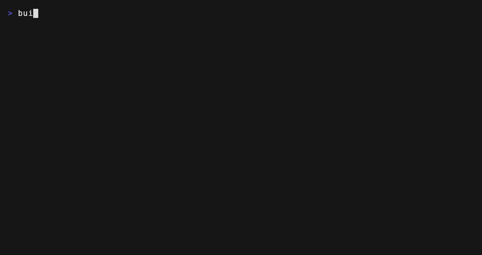
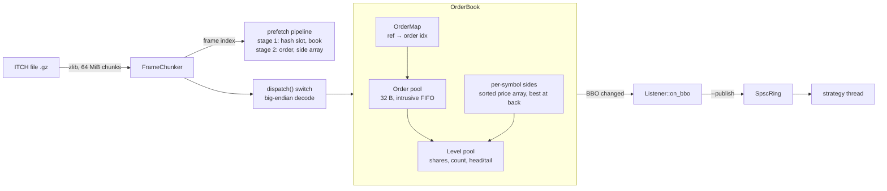
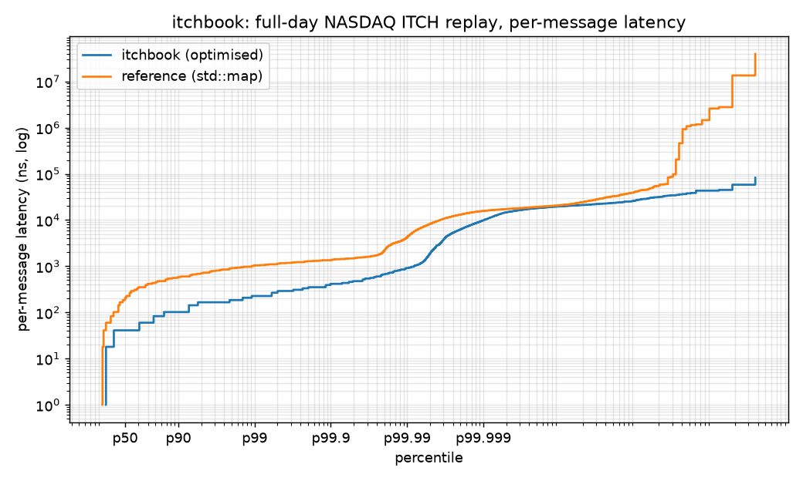

# itchbook

A NASDAQ TotalView-ITCH 5.0 feed handler and full-depth (L3) order book in C++20. It is the
component of an equities trading stack that turns the exchange's order-by-order feed into
per-symbol books and BBO events for strategies. It is verified message-by-message against a
reference implementation on a full real trading day.

[](https://github.com/eshaan2418/itchbook/actions/workflows/ci.yml)


> Educational/research project. Not investment advice. No live trading.

## Headline numbers

Full NASDAQ trading day, 2019-01-30: 368,366,634 messages, 11.2 GB decompressed, 8,714 symbols.
Measured on an Apple M5 Pro laptop (macOS 27.0.1, Apple clang 21, `-O3 -mcpu=native`). Values are
medians of 5 full-day runs unless noted. Raw output is in
[`bench/results/20261101-071441/`](bench/results/20261101-071441/SUMMARY.md).

| metric | value |
|---|---|
| Book throughput, full day (decode + L3 book + BBO detection) | **20.2 M msgs/s** (49 ns/msg; 5-run range 19.5-21.8) |
| Same, `std::map`/`std::list` reference book | 3.9 M msgs/s (**5.2× slower**) |
| Per-message latency, p50 / p99 / p99.9 / p99.99 | **42 / 250 / 417 / 917 ns** (timer quantum ≈ 42 ns, see caveats) |
| End-to-end incl. single-threaded zlib decompression | 12.3 M msgs/s (full day in 30 s) |
| BBO hand-off to a strategy thread (SPSC ring), p50 / p99 | 125 / 209 ns over 174.9 M BBO events, 0 producer stalls |
| Differential check vs reference, full day | **0 mismatches** over 363,118,215 book messages |
| Feed integrity, full day | 0 unknown refs, 0 duplicate adds, 0 overfills, 0 orders left at end of day |
| Peak live orders / price levels | 1,742,866 / 707,130; peak RSS 337 MB |

## Demo

`make demo` replays the day and prints a live AAPL book from the open
([tape](research/demo.tape)):



## Why it matters

ITCH is an L3 feed: NASDAQ publishes every add, execute, cancel, replace and delete, and every
consumer must rebuild the book itself. The handler sits on the critical path between the wire and
every equity strategy, so its latency adds directly to tick-to-trade and its tail latency decides
behaviour during bursts. It must also be exactly right. One misapplied message (a replace that
keeps priority, a partial execution applied twice) silently corrupts a symbol's book until the
order is deleted, possibly hours later. Market makers, stat-arb desks and execution algorithms all
depend on this component.

## Highlights

- **Verified on a full real day**: an independent `std::map` reference book runs in lockstep. The
  top 10 levels are compared after each of 363M book messages, full depth every 1000th message,
  and every symbol at end of day. Result: 0 mismatches, and every integrity counter is zero.
- **Allocation-free steady state, verified**: a replaced global `operator new` proves zero heap
  allocations after warm-up in tests. On the real day, the only allocations (291 over 368M
  messages) are per-symbol level arrays growing the first time a book gets unusually deep. This is
  measured and explained in the perf log.
- **Memory-latency engineering**: an open-addressing order map (Fibonacci hashing,
  backward-shift deletion, 16-byte slots), 32-byte pooled orders linked by 32-bit indices, and
  price levels in a sorted array with the touch at `back()`. A **two-stage software-prefetch
  pipeline** reads refs 16 messages ahead: +27-40% throughput over no prefetch (two sessions).
- **No exceptions, no RTTI, no virtual dispatch** on the hot path: handlers are template
  parameters, so the book update inlines into the parser's switch.
- **Lock-free SPSC hand-off** to a strategy thread with acquire/release-only ordering and 128-byte
  padding (Apple M-series `hw.cachelinesize`), stress-tested under TSan in CI.
- **Fuzzed and sanitised**: libFuzzer harness over the parser and both books (CI, ASan+UBSan),
  RapidCheck property tests, sanitizer jobs on every push.

## Quick start

```bash
# macOS (Homebrew)            # Ubuntu/Debian
brew install cmake ninja      # sudo apt-get install -y cmake ninja-build zlib1g-dev clang

make build test               # Release build + 34 tests (GoogleTest, RapidCheck)
make data                     # download the NASDAQ 2019-01-30 ITCH sample (4.7 GB, SHA-256 pinned)
make verify                   # full-day differential check vs the reference book (~7 min)
make bench                    # full benchmark suite (~30 min, run on an idle machine)
make demo SYMBOL=AAPL         # live top-of-book replay (synthetic data if the sample is absent)
```

The CLI works on any ITCH 5.0 file, gzip or raw, or `-` for stdin:

```bash
build/itchbook stats  FILE                       # message mix, peak live orders/levels
build/itchbook replay FILE --prefetch 16 --prefetch-stages 2 [--latency] [--publish]
build/itchbook verify FILE --depth 10 --full-every 1000
build/itchbook top    FILE --symbol MSFT --from 10:00 --depth 5
build/itchbook gen    synth.itch.gz --messages 2000000   # reproducible synthetic flow
build/itchbook timer                             # timer resolution and read overhead
```

The data is NASDAQ's public sample from <https://emi.nasdaq.com/ITCH/Nasdaq%20ITCH/>. It is not
redistributed here. Files are stream-decompressed and never written to disk uncompressed.

## Architecture



**Data flow.** Decompressed bytes land in a reusable 64 MiB buffer, and a partial trailing frame
carries over to the next chunk. The replay loop builds an index of frame pointers. That lets the
prefetcher look 16 and 8 messages ahead while `dispatch()` decodes the current message into a stack
POD and calls the book. The book updates the order map, order record, level and side array, then
compares the symbol's new top of book with its cached BBO and calls the listener only on change.

**Threading model.** One thread owns the parser and all books: no locks or atomics on the book
path. This mirrors production, where NASDAQ shards symbols across feed partitions and each
partition gets one handler core. The only cross-thread edge is BBO events to a consumer over a
bounded SPSC ring with explicit back-pressure (counted stalls, never silent drops).

The structures, and the alternatives rejected, are covered in [`docs/DESIGN.md`](docs/DESIGN.md).
The market mechanics the code relies on are in [`docs/MICROSTRUCTURE.md`](docs/MICROSTRUCTURE.md).

## Correctness

| layer | what it checks |
|---|---|
| Reference model | `ReferenceBook`: `std::map` per side, `std::list` FIFO per level, `unordered_map` index; written for obviousness |
| Differential tests | full depth and every FIFO queue compared after every message on synthetic flow (all message types, deep/shallow books, injected violations); linear, binary and hybrid level search |
| Property tests | RapidCheck random op sequences incl. ops on dead/unknown refs; invariants: level shares = sum of orders, count = orders, no empty levels, codec round-trip |
| Unit tests | price-time priority, replace loses priority, partial execution/cancel, BBO emitted only on top-of-book change, integrity counters |
| Allocation test | zero `operator new` calls over 1M messages after warm-up |
| Fuzzing | libFuzzer over arbitrary bytes into both books; aborts if they disagree (CI, ASan+UBSan, time-boxed) |
| Sanitizers | ASan+UBSan and TSan CI jobs run the whole suite, including the two-thread SPSC stress test |
| Real data | `itchbook verify` on the full day: 0 mismatches, integrity counters equal and zero, 0 live orders at end of day ([result](bench/results/verify_01302019.json)) |

The tests were mutation-checked: a planted bug (partial executions not reducing level shares)
fails 8 test cases.

Invariants enforced on every message: order-ID lifecycle (no add of a live ref, no operation on an
unknown ref), quantities never negative (overfills counted), level aggregates consistent. Crossed
books are **counted, not asserted**, because NASDAQ's displayed book can pass through transient
crossed states. On the sample day 663 of 363M book messages left the affected book crossed (8
pre-open, 655 regular hours, 0 post-close), identically in both implementations.

## Performance

**Methodology.**
- Full-day replay, Release build (`-O3 -mcpu=native`), machine otherwise idle, thermal state
  recorded per run (no thermal or performance warnings in any run).
- Thread QoS is `USER_INTERACTIVE` to prefer performance cores. macOS cannot pin threads.
- 5 runs per configuration; medians reported with run-to-run CV.
- *Book throughput* times decode + book + BBO detection, including the frame-index pass.
  Decompression is excluded and reported separately as end-to-end.
- *Latency mode* timestamps each `dispatch()` individually into an HdrHistogram-style log-linear
  histogram (exact below 2048, <0.1% relative error above).
- Warm-up is not excluded from the tables: the full day, including the first chunk, is reported.

| configuration (full day) | Mmsg/s, session A | Mmsg/s, session B |
|---|---|---|
| optimised, 2-stage prefetch (default) | **21.1** (CV 0.4%) | **20.2** (CV 4.6%) |
| optimised, 1-stage prefetch (hash slot only) | 19.3 | 18.6 |
| optimised, no prefetch | 15.1 | 15.9 |
| hybrid level search (8-entry scan + binary) | 20.1 | 20.5 |
| binary level search | 16.8 | 16.5 |
| reference (`std::map` + `std::list` + `unordered_map`) | 3.8 | 3.9 |

Session A ([`20261101-062825`](bench/results/20261101-062825/SUMMARY.md)) ran on a quiet machine
with a 64-level side reserve. Session B ([`20261101-071441`](bench/results/20261101-071441/SUMMARY.md))
uses the current defaults (256-level reserve, which by itself has no measurable throughput effect:
PERF_LOG §7) but had other load on the laptop (load average ~3.4), hence the wider run-to-run
spread. Within-session comparisons are reliable; cross-session drift is up to ~5%.

Per-message latency, session B (ns, median of 5 runs, [min-max across runs]):

| | p50 | p90 | p99 | p99.9 | p99.99 | max |
|---|---|---|---|---|---|---|
| optimised | 42 | 125 | 250 [209-250] | 417 [375-417] | 917 [875-917] | 110 µs [66 µs-2.3 ms] |
| reference (1 run) | 208 | 584 | 1,042 | 1,375 | 4,248 | 126 ms |



**Caveats, stated plainly.**
- **Timer.** On the M5 the architected counter reports 1 GHz but advances in ~41.7 ns steps
  (24 MHz; occasional ~17 ns steps), measured by `itchbook timer`. p50 = 42 ns means "one counter
  step". The low percentiles are quantised; the tails are far above the quantum. Each read costs
  9 ns (`ISB` + `MRS`; 8.7 and 9.5 ns in the two sessions), and the serialising `ISB` also
  defeats memory-level parallelism: latency mode runs at 15.5 M msgs/s against 20.2 M untimed. Throughput numbers are the more
  accurate measure of per-message cost.
- **Max latency** (66 µs to 2.3 ms across runs) is OS preemption or page-fault territory on a
  laptop, not the algorithm.
- **Laptop, not colo.** No isolated cores, no kernel bypass, no huge pages, macOS scheduler,
  shared SLC with the rest of the system. A tuned Linux server with `isolcpus` and huge pages
  would show tighter tails. CI micro-benchmarks run on shared runners and are informational only.
- **Publish mode** costs throughput (15.7 M msgs/s): 47% of messages change a BBO, and each event
  is timestamped and pushed. The hand-off p99.9 (7-11 µs) reflects the consumer thread being
  descheduled; busy-polling without core isolation cannot avoid that on macOS.
- **Workload.** Only the 2019-01-30 sample day was benchmarked.

Every optimisation step with its measured effect (prefetch distance and stages, level-search
variants, side-array reserve and allocations) is in [`docs/PERF_LOG.md`](docs/PERF_LOG.md).
Micro-benchmarks (Google Benchmark) on synthetic flow: `make micro`.

## Design decisions and trade-offs

| decision | chosen | rejected, and why |
|---|---|---|
| ref → order lookup | open addressing, linear probing, backward-shift delete | `std::unordered_map` (node per insert, pointer chasing); direct-indexed array (max ref on the sample day is 329,176,641: 1.3 GB of u32 slots, mostly empty, and unbounded on busier days); tombstones (degrade over a day of ~192M inserts and ~190M erases) |
| price levels | sorted array, best at back, linear scan from touch | `std::map` (allocation + dependent misses per level; ~5× slower overall); binary search (slower on this workload: activity clusters at the touch); dense price array (unbounded range across 8.7k symbols) |
| order links | 32-bit pool indices | pointers (twice the size, invalidated by pool growth) |
| dispatch | templates + `switch` | virtual handlers (indirect call per message, no inlining) |
| BBO detection | compare cached top-of-book after each message | per-operation case analysis (more branches, easy to get wrong) |
| threading | single thread per feed, SPSC to consumers | parse/book pipeline across cores (hand-off costs more than the work) |
| slow consumer | spin and count stalls | silent drop; conflation is better for production (see roadmap) |
| prices | u32 fixed-point as on the wire | floating point (inexact compares, conversion cost) |

## Limitations and roadmap

- File replay only. Next: MoldUDP64 session layer (sequence-gap detection, A/B line arbitration,
  retransmission requests) and SoupBinTCP.
- Linux fast path: AF_XDP or ef_vi receive straight into the zero-copy parser, `isolcpus` and
  `nohz_full`, huge pages for the order map and pools, `rdtscp`-based timing.
- Conflating per-symbol BBO publication (latest-value slots plus a dirty bitmap) instead of a
  lossless queue.
- Pre-sizing side arrays from the previous day's maximum depth, to remove the remaining
  first-touch allocations.
- Attributing each crossed-book occurrence (join with trading-action `H` messages and auction
  periods).
- FPGA offload of decode and top-N books, with this book as the differential oracle.

## Related projects

itchbook is the market-data entry point of a portfolio trading stack. Later projects (matching
engine, L3 backtester with queue-position modelling) consume its book and events. Links will be
added as they are published.

## Project structure

```
include/itchbook/   messages.hpp (wire format) parser.hpp order_map.hpp order_book.hpp
                    reference_book.hpp spsc_ring.hpp latency.hpp synth.hpp gz_reader.hpp
src/                gzip reader, synthetic flow generator
tools/              itchbook CLI (replay, verify, stats, top, gen, timer), allocation counter
tests/              GoogleTest + RapidCheck suites
fuzz/               libFuzzer harness
bench/              micro-benchmarks, full-day benchmark scripts, raw results
research/           plotting script, plots, demo tape
scripts/            data download with pinned checksum
docs/               DESIGN, MICROSTRUCTURE, PERF_LOG, DEEP_DIVE (interview Q&A)
```

## License

MIT. See [LICENSE](LICENSE).

Educational/research project. Not investment advice. No live trading. NASDAQ TotalView-ITCH sample
data is © Nasdaq, Inc. and is downloaded from Nasdaq's public site; it is not included in this
repository.
